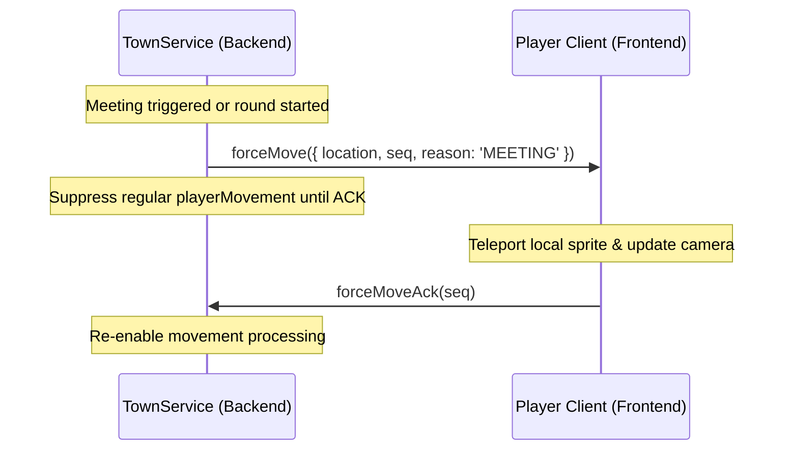

# Impostor Game Mode: Shared Types and Socket Protocol (Task 1.A1)

## Overview

This document specifies the shared TypeScript type contracts and Socket.IO event protocol for the **Impostor** game mode in Covey.Town (Task 1.A1). These contracts are defined in [`shared/types/CoveyTownSocket.d.ts`](../shared/types/CoveyTownSocket.d.ts) and form the foundational interface shared across the backend (`townService`) and the frontend (`frontend`).

The protocol is designed around three core principles:
1. **Asymmetric State Partitioning**: Secret information (such as Impostor identities and individual tasks) is separated from public room state to prevent client-side inspection exploits.
2. **Vote Secrecy during Voting**: During emergency discussions, only the list of players who have voted is public. Individual votes and ejection outcomes are revealed strictly in the results phase.
3. **Server-Authoritative Teleportation**: Meetings, round spawns, and kill snaps use an explicit sequence-numbered handshake (`forceMove` and `forceMoveAck`) to prevent desynchronization.

---

## 1. Game State Models

### 1.1 Public Game State (`ImpostorGameState`)

The public state is broadcast to all players inside the Impostor game area (`ImpostorArea`) via `interactableUpdate`. It contains all shared game progression metrics, but omits secret role assignments.

```typescript
export interface ImpostorGameState extends GameState {
  /** Winning team if the game has ended */
  winner?: ImpostorTeam;
  /** PlayerIDs of players who are still alive */
  alivePlayers: ReadonlyArray<PlayerID>;
  /** PlayerIDs of players who have died or become ghosts */
  deadPlayers: ReadonlyArray<PlayerID>;
  /** Total number of tasks completed across all crewmates */
  tasksCompleted: number;
  /** Total number of tasks required to achieve a task victory */
  totalTasks: number;
  /** Whether an emergency meeting or body report is currently active */
  isMeetingActive: boolean;
  /** Current phase of the active emergency meeting */
  meetingPhase?: ImpostorMeetingPhase;
  /** PlayerID of the player who triggered the meeting or reported a body */
  meetingCaller?: PlayerID;
  /** PlayerIDs of players who have cast a vote during the current meeting */
  hasVoted?: ReadonlyArray<PlayerID>;
  /** Recorded votes; only populated when meetingPhase === 'RESULTS' */
  votes?: ReadonlyArray<ImpostorVote>;
  /** The player ejected during the meeting, or 'SKIP' / 'TIE'; only in RESULTS */
  ejectedPlayer?: PlayerID | 'SKIP' | 'TIE';
  /** Remaining countdown in seconds for discussion or voting */
  meetingTimerSec?: number;
}
```

#### Meeting Phases:
- `'DISCUSSION'`: Free discussion time. Voting buttons are disabled; countdown timer is active.
- `'VOTING'`: Voting is open. Players submit votes. `hasVoted` is updated with voter IDs, while `votes` remains undisclosed.
- `'RESULTS'`: Voting concludes. The server populates `votes` (who voted for whom) and `ejectedPlayer`, revealing the outcome to all clients.

---

### 1.2 Private Game State (`ImpostorPrivateState`)

The private state is sent individually to each connected player's socket via `impostorPrivateUpdate`. It delivers confidential information and player-specific cooldowns.

```typescript
export interface ImpostorPrivateState {
  /** Unique identifier of the game instance this private state belongs to */
  gameID: GameInstanceID;
  /** Secret role assigned to this player */
  role: ImpostorRole;
  /** PlayerIDs of fellow impostors (only populated if this player is an impostor) */
  impostorTeammates?: ReadonlyArray<PlayerID>;
  /** Personal task list assigned to this player */
  tasks: ReadonlyArray<ImpostorTask>;
  /** Epoch timestamp in milliseconds when the kill cooldown expires (impostor only) */
  killCooldownEndsAt?: number;
  /** Epoch timestamp in milliseconds when the sabotage cooldown expires (impostor only) */
  sabotageCooldownEndsAt?: number;
}
```

- **Timestamp Cooldowns**: `killCooldownEndsAt` and `sabotageCooldownEndsAt` represent absolute server timestamps (epoch ms). This allows the frontend to render smooth client-side circular timers without requiring 1-second server polling loops.
- **`gameID`**: Identifies which game area instance the private state belongs to, allowing frontend controllers to route updates deterministically.

---

## 2. Server-Authoritative Movement (`forceMove`)

Emergency meetings, round spawns, and kill executions require teleporting players to designated coordinates (e.g. the meeting table). To prevent race conditions where a client's buffered `playerMovement` overwrites a teleport, the server uses a sequence-numbered handshake:



### Event Signatures:

#### In `ServerToClientEvents`:
```typescript
/**
 * Forces a player to move to a designated location (e.g. teleporting to emergency meeting
 * table or round spawn point).
 * @param payload Target location, sequence number, and context reason.
 */
forceMove: (payload: ForceMovePayload) => void;
```

#### In `ClientToServerEvents`:
```typescript
/**
 * Acknowledges receipt of a forced repositioning event from the server.
 * @param seq The sequence number of the forceMove that is being acknowledged.
 */
forceMoveAck: (seq: number) => void;
```

#### Supporting Types:
```typescript
export type ForceMoveReason = 'MEETING' | 'KILL' | 'SPAWN';

export interface ForceMovePayload {
  location: Partial<PlayerLocation>;
  seq: number;
  reason: ForceMoveReason;
}
```

---

## 3. In-Game Moves and Commands

Player actions within an Impostor game area are encapsulated by `ImpostorMove` and dispatched via `ImpostorCommand`.

### 3.1 `ImpostorMove` (Discriminated Union)

```typescript
export type ImpostorMove =
  | ImpostorCallMeetingMove
  | ImpostorReportBodyMove
  | ImpostorCastVoteMove
  | ImpostorCompleteTaskMove
  | ImpostorKillPlayerMove
  | ImpostorSabotageMove;

export interface ImpostorCallMeetingMove {
  moveType: 'CallMeeting';
}

export interface ImpostorReportBodyMove {
  moveType: 'ReportBody';
  victimID: PlayerID;
}

export interface ImpostorCastVoteMove {
  moveType: 'CastVote';
  target: PlayerID | 'SKIP';
}

export interface ImpostorCompleteTaskMove {
  moveType: 'CompleteTask';
  taskID: string;
}

export interface ImpostorKillPlayerMove {
  moveType: 'KillPlayer';
  victimID: PlayerID;
}

export interface ImpostorSabotageMove {
  moveType: 'Sabotage';
  sabotageType: string;
}
```

### 3.2 `ImpostorCommand`

Dispatched through `interactableCommand`:

```typescript
export interface ImpostorCommand {
  type: 'ImpostorCommand';
  gameID: GameInstanceID;
  move: ImpostorMove;
}
```

---

## 4. Interactables & Map Integration

To allow seamless integration across map builders, Phaser scene controllers, and server models:
- **`InteractableType`**: Contains both `'ImpostorArea'` (logical game area model) and `'ImpostorArcade'` (physical arcade cabinet object in the tilemap).
- **`ImpostorArea`**: Defined as `GameArea<ImpostorGameState>`.
